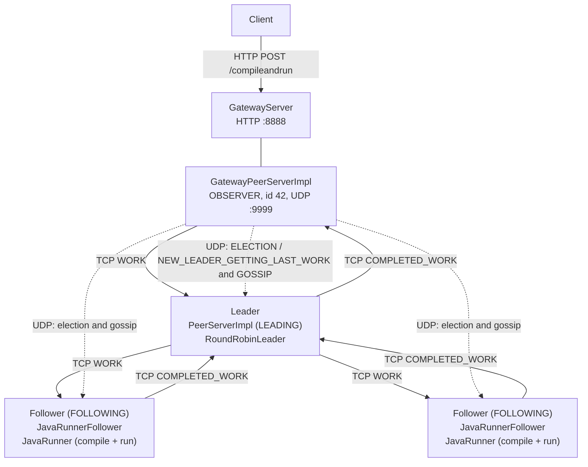

# Fault-Tolerant Distributed Java Compile-and-Run Service

A small ZooKeeper-style cluster. Clients send Java source code over HTTP to a **gateway**. The gateway passes each job to the cluster's elected **leader**. The leader hands jobs out round-robin to **followers**, which compile and run the code and send the output back the same way.

Servers find out about failures through **gossip heartbeats**. When the leader dies, the remaining servers elect a new one with a simplified **ZooKeeper Fast Leader Election**. The gateway sends new work to the new leader, and results that were finished under the old leader are delivered through the new one.

For the list of fault-tolerance bug fixes and why each was needed, see [`CHANGES.md`](CHANGES.md).

---

## Contents
1. [Architecture](#1-architecture)
2. [Ports](#2-ports)
3. [Message format](#3-message-format)
4. [Components](#4-components)
5. [Lifecycle of a request](#5-lifecycle-of-a-request)
6. [Leader election](#6-leader-election)
7. [Failure detection (gossip)](#7-failure-detection-gossip)
8. [Failure handling](#8-failure-handling)
9. [Building and running tests](#9-building-and-running-tests)
10. [Logging](#10-logging)


---

## 1. Architecture



### Roles (`PeerServer.ServerState`)

| State | Char | Meaning |
|---|---|---|
| `LOOKING` | `O` | Taking part in a leader election |
| `LEADING` | `E` | The elected leader; runs `RoundRobinLeader` |
| `FOLLOWING` | `F` | A worker; runs `JavaRunnerFollower` |
| `OBSERVER` | `B` | The gateway. It receives election results but never votes and never runs jobs |

---

## 2. Ports

Every peer has a **UDP port** given in the configuration. Its **TCP port is UDP port + 2**.

| Port | Protocol | Used by | Purpose |
|---|---|---|---|
| `udpPort` | UDP | `UDPMessageReceiver` | Election and gossip messages |
| `udpPort + 2` | TCP | `RoundRobinLeader` (on the leader) **or** `JavaRunnerFollower` (on a follower) | Work and results |
| `udpPort + 2` | TCP | `GatewayPeerServerImpl` | Results coming back from the leader |
| `httpPort` | HTTP | `GatewayServer` | Client requests |

Because the leader and follower roles use the same TCP port, a follower that is promoted to leader must close its follower socket before the leader socket can be opened. `PeerServerImpl.run` does this.

In the tests: peers use UDP `2500 + 3·i` (with an offset that grows for each cluster a test creates). The gateway is id `42`, UDP `9999`, HTTP `8888`.

---

## 3. Message format

`Message` (in `edu.yu.cs.com3800`) is the format for every message, over both UDP and TCP. `getNetworkPayload()` encodes it in this order (big-endian `ByteBuffer`):

| Field | Type | Bytes |
|---|---|---|
| message type | `char` | 2 |
| request ID | `long` | 8 |
| error occurred | `byte` | 1 |
| sender port | `int` | 4 |
| sender host length + bytes | `int` + `byte[]` | 4 + n |
| receiver port | `int` | 4 |
| receiver host length + bytes | `int` + `byte[]` | 4 + n |
| content length + bytes | `int` + `byte[]` | 4 + n |

`new Message(byte[])` decodes it.

### Message types

| Type | Transport | Sender → receiver | Contents |
|---|---|---|---|
| `ELECTION` | UDP | peer → peer | `ElectionNotification` (see §6) |
| `NEW_LEADER_GETTING_LAST_WORK` | UDP | peer → all | `ElectionNotification` for the winner; sent when an election ends |
| `GOSSIP` | UDP | peer → peers | A Java-serialized `ConcurrentHashMap<Long, Long>` heartbeat table |
| `WORK` | TCP | gateway → leader → follower | Java source code |
| `COMPLETED_WORK` | TCP | follower → leader → gateway | Program output, or the exception message |

`requestID` is assigned by the gateway and stays the same through every hop. This is how the gateway matches a result to the HTTP request waiting for it, even if a different leader forwards the result.

---

## 4. Components

### Package `edu.yu.cs.com3800` (shared infrastructure)

| Class | Role |
|---|---|
| `PeerServer` | Interface for a cluster member: state, leader, epoch, sending messages, peer lookup, `isPeerDead`. Also defines the `ServerState` enum. |
| `Message` | Message encoding and decoding (§3). |
| `Vote` | `(proposedLeaderID, peerEpoch)`. |
| `ElectionNotification` | A `Vote` plus the sender's `state` and `senderID`. |
| `LeaderElection` | Runs one round of election (§6). Creating one **increments the server's epoch**. |
| `UDPMessageSender` | Thread that empties `outgoingMessages` and sends each one as a UDP datagram. |
| `UDPMessageReceiver` | Thread that receives UDP packets and sorts them (see below). |
| `JavaRunner` | Compiles a source string in memory with `javax.tools`, finds the `public class`, and calls its `run()` method, which returns a `String`. |
| `LoggingServer` | Mixin that creates a logger writing to `logs-<timestamp>/<name>-Log.txt`. |
| `Util` | Helpers for reading streams. `readAllBytesFromNetwork` polls `available()` (up to 10 × 500 ms) and then reads. |

#### How `UDPMessageReceiver` sorts packets
1. Packets from a peer marked dead (`peerServer.isPeerDead(sender)`) are **dropped**.
2. `GOSSIP` → gossip queue.
3. `ELECTION` from a LOOKING or OBSERVER peer while this server is FOLLOWING or LEADING → this server **replies directly** with who the current leader is, so the sender can catch up.
4. `ELECTION` from a non-LOOKING peer while this server already has a leader → **dropped** as stray.
5. Anything else → election/control queue (`notGossipe` in `PeerServerImpl`).

### Package `edu.yu.cs.com3800.stage5` (cluster logic)

#### `PeerServerImpl`
One cluster member, which runs on its own thread.
- **Constructor:** sets up the queues, starts `UDPMessageSender` and `UDPMessageReceiver`, and sets state to `LOOKING`. Quorum is `peerIDtoAddress.size() / 2`. The map leaves out the server itself but includes the gateway.
- **`run()`:**
  1. Starts the gossip heartbeat (`beatHart`).
  2. Runs `LeaderElection.lookForLeader()`.
  3. Starts `RoundRobinLeader` if it is LEADING, otherwise `JavaRunnerFollower`.
  4. Loops every 200 ms:
     - **FOLLOWING:** if `isPeerDead(leader)`, clears `currentLeader`, re-elects, opens the leader socket if promoted, and starts re-sending results it has kept to the new leader (§8).
     - **LEADING:** passes newly failed workers to `roundRobinLeader.workerfail()`.
- **`isPeerDead(id | address)`:** checks the `isalive` map. (Despite its name, that map holds the peers that are **dead**.)
- **`shutdown()`:** stops the gossip timer, the UDP threads, and the leader/follower socket, so the server goes completely silent like a crashed machine.
- **Inner class `beatHart`:** the gossip failure detector (§7).

#### `RoundRobinLeader` (runs only on the leader)
- Listens on TCP `udpPort + 2`.
- **`WORK`** (from the gateway): `Allocjob` picks the next worker round-robin from `peerSeverIDs` (live peers other than the gateway), records the job in `Jmesseges`, `JobsToWorker`, and `WorkersToJobs`, and sends it to that follower's TCP port.
- **`COMPLETED_WORK`** (from a follower): `freeJob` clears the job's records, then `sendToGateWay` forwards the result to the gateway's TCP port. **This happens even if this leader never assigned the job**, which is how results finished under a dead leader get through.
- **`workerfail(ids)`:** removes the failed workers and reassigns their outstanding jobs with `reAlloc`.
- **`shutdown()`:** closes the socket; `run()` exits.

#### `JavaRunnerFollower` (runs on each follower)
- Listens on TCP `udpPort + 2` for `WORK`, runs it with `JavaRunner`, and calls `deliverResult`.
- **`deliverResult(jobId, result)`:** waits while an election is running, then keeps trying to send to whoever is the current leader every 500 ms until it succeeds. It sends to its own address if it has become the leader itself.
- **`deliveredResults`:** the last 100 results it has delivered. **`resendToNewLeader()`** sends them again after an election, in case the old leader died before forwarding them.
- **`shutdown()`:** closes the socket; `run()` exits.

#### `GatewayServer`
- A `com.sun.net.httpserver.HttpServer` with the context `/compileandrun`.
- Accepts only `POST` with `Content-type: text/x-java-source`. Other methods get `405`, other content types get `400`.
- Waits until the gateway knows a leader, gives the request the next `requestID`, queues it with `gatewayPeerServer.setmessge`, waits for the result, and returns it as `200 text/plain`.

#### `GatewayPeerServerImpl` (extends `PeerServerImpl`; state is always `OBSERVER`)
- Takes part in gossip, but **never votes**. It learns who the leader is from `NEW_LEADER_GETTING_LAST_WORK` messages (`leaderchecker`) and ignores any that name a dead peer.
- Main loop:
  - if the leader is dead, clear it and wait for the next `NEW_LEADER` message;
  - accept `COMPLETED_WORK` on TCP and store it in `requestrespons` for the HTTP handler;
  - send queued `WORK` to whoever is the **current** leader. If the send fails, put it back on the queue and retry.

#### `feedback`
A mutable `int` holder that the worker classes use for status codes from helper methods.

---

## 5. Lifecycle of a request

```
Client          Gateway                     Leader                     Follower
  │ POST src  ──►│                              │                          │
  │              │ wait for currentLeader       │                          │
  │              │ requestID = id++             │                          │
  │              │── TCP WORK(id) ─────────────►│                          │
  │              │                              │ Allocjob → pick worker   │
  │              │                              │── TCP WORK(id) ─────────►│
  │              │                              │                          │ JavaRunner.compileAndRun
  │              │                              │◄── TCP COMPLETED_WORK(id)│ deliverResult
  │              │◄── TCP COMPLETED_WORK(id) ───│ freeJob, sendToGateWay   │
  │              │ requestrespons[req] = out    │                          │
  │◄─ 200 out ───│                              │                          │
```

---

## 6. Leader election

`LeaderElection.lookForLeader()` is a simplified version of ZooKeeper's FastLeaderElection.

1. Each server starts by voting for itself `(myId, epoch)` and broadcasts that vote as an `ELECTION` notification:
   `ElectionNotification = [long proposedLeader][char state][long senderId][long epoch]` (26 bytes).
2. While it receives notifications:
   - It ignores notifications from an earlier epoch and from OBSERVERs.
   - If the received vote **supersedes** its own (higher epoch, or the same epoch and a higher leader ID), it switches to that vote and broadcasts it.
   - It records each sender's latest vote.
   - If nothing arrives, it sends its notifications again and backs off exponentially (10 ms, doubling, up to 30 s).
3. When **more than `quorum`** votes match its current proposal, it waits `finalizeWait` (300 ms) and empties the queue. If none of those votes is better, it accepts the result:
   - broadcasts `NEW_LEADER_GETTING_LAST_WORK`;
   - becomes `LEADING` if it won, `FOLLOWING` otherwise;
   - clears its incoming queue.

**Outcome:** among the servers that are alive, the one with the highest ID (in the highest epoch) becomes leader. Every new `LeaderElection` increments the server's epoch, so messages from earlier elections are ignored.

**Quorum example:** 4 peers + gateway. Each server's map has 4 entries (3 other peers + gateway), so quorum = 2 and more than 2 matching votes (that is, 3) are needed. After one peer dies, all 3 survivors must agree.

---

## 7. Failure detection (gossip)

This is `PeerServerImpl.beatHart`, and every server runs it, including the gateway.

**Each server keeps** a heartbeat table `vervtorclock: id → last heartbeat value seen`.

**Every 1 s** (`GOSSIP = 1000` ms, on a daemon `Timer`):
1. Increase its own counter (`timeCount`) and write it into its own entry.
2. Any peer whose entry is more than `FAIL = 10` beats old is marked dead: added to `timedOut`, `dead`, and `isalive`.
3. Entries more than `CLEANUP = 20` beats old are removed.
4. Send the table (Java-serialized) as `GOSSIP`. With 3 or fewer other peers it goes to all of them, otherwise to 3 peers chosen in rotation.

**On receiving gossip** (a separate daemon thread): for each entry, it takes the incoming value if it is newer than the local one and the peer has not already timed out. Once a peer is marked dead, later gossip never brings it back.

**Timing:** a crashed peer is detected about **10–12 s** after its last heartbeat.

---

## 8. Failure handling

### Follower dies
`beatHart` adds it to `dead`. The leader's main loop calls `RoundRobinLeader.workerfail()`, which removes it from the round-robin list and reassigns its outstanding jobs to the remaining workers.

### Leader dies
1. **Detection:** about 10 s later, each follower's main loop sees `isPeerDead(leader)`.
2. **Re-election:** the follower sets `currentLeader = null`, so the receiver stops dropping election messages as stray, and runs a new `LeaderElection` (new epoch). Packets from the dead leader are dropped by `UDPMessageReceiver`.
3. **Promotion:** the winner closes its `JavaRunnerFollower` socket and starts a `RoundRobinLeader` on the same port. Its worker list leaves out the dead peer.
4. **Gateway:** sees the leader is dead, clears `currentLeader`, and takes the next `NEW_LEADER_GETTING_LAST_WORK` that names a live peer. Queued and future requests go to the new leader.
5. **Results finished under the old leader:**
   - If the follower finishes a job while the leader is down, `deliverResult` keeps retrying until the new leader accepts it.
   - If the old leader received a result and died before forwarding it, the follower's `resendToNewLeader()` sends it again.
   - Either way, the new leader's `RoundRobinLeader` forwards the result to the gateway, which matches it to the waiting HTTP request by `requestID`. Duplicate results are harmless.

---

## 9. Building and running tests

### Requirements
- JDK 21 (installed at `C:\Program Files\Java\jdk-21`; JDK 17 is also installed).
- Maven 3.9.x.
- JUnit Jupiter (pulled in by `pom.xml`).

### Environment notes
- **`JAVA_HOME`** must point to a **JDK folder**. It currently points to `jdk-21_windows-x64_bin.exe`, which is the installer, so `mvn` won't start.
- **`pom.xml`** sets the compiler plugin to `<source>/<target>24`, and no JDK 24 is installed. Either change those to `21` or pass `-Dmaven.compiler.release=21` as shown below.

### Commands (Git Bash)
```bash
export JAVA_HOME="C:/Program Files/Java/jdk-21"

# a single test
mvn test -Dtest=PeerServerImplTest#shutdownLeader -Dmaven.compiler.release=21
```

### Tests (`src/test/java/edu/yu/cs/com3800/stage3/PeerServerImplTest.java`)

| Test | Scenario | Time |
|---|---|---|
| `basicHappy` | 2 peers + gateway; one request returns `"happy path\n"` | ~6 s |
| `shutdownLeader` | 4 peers; leader (id 3) killed while idle; a request after re-election succeeds | ~47 s |
| `shutdownLeaderWhileFollowerWorking` | 4 peers; leader killed while a follower runs a 5 s job; the result still reaches the client through the new leader | ~30 s |
| `chachingwithhappy` | Two identical requests in a row | — |
| `tt2`, `ttt`, `ttt2` | Manual or exploratory: **they never finish** (`while(true);`) | — |
| `vve` | Serializing a `HashMap` (used by gossip) | — |

> Run the cluster tests **one at a time**. Each test opens real ports (HTTP 8888, UDP 9999, …) and doesn't fully release them, so running the whole class in one JVM can fail with "address in use". Tests read their Java source inputs from paths relative to the project root.

Test inputs are `HappyPath.java` (returns `"happy path\n"`) and `HappyWaitPath.java` (sleeps 5 s, then returns `"happywait   \n"`). The gateway sends their source to the cluster as jobs.

---

## 10. Logging

`LoggingServer.initializeLogging(name)` writes to `./logs-yyyy-MM-dd-HH_mm/<name>-Log.txt`, in a new folder for each minute in which a run starts. Useful files:

| File prefix | What's in it |
|---|---|
| `serverimp<id>` | Main log for each server: state changes, dead-leader detection, the leader/follower job logic |
| `server<id>gosip` | Gossip and failure detection |
| `...election` | Each election round, one file per server thread |
| `...UDPMessageReceiver-on-port-<p>` | Received UDP packets |

Useful log lines when debugging a failover:
- `leader N is dead, starting new election`
- `initializing ring leader`
- `could not send result of job … will retry`
- `re-sending K completed results to new leader`

---


